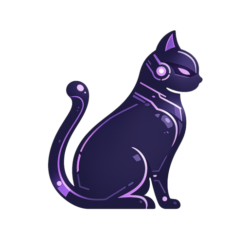

# Cat's Bot

Cat's Bot reúne herramientas de moderación, conversación con IA, radio y gestión del servidor en un bot de Discord con panel web.

## Funciones

| Área | Qué incluye |
| --- | --- |
| 🛡️ Moderación | AutoMod, casos y configuración por servidor; moderación LLM opcional. |
| 💬 IA | Chat Strata con recuerdos por ámbito y recuerdos personales opcionales; Gemini se conserva como alternativa. |
| 🌐 Investigación | Búsqueda pública con DuckDuckGo/Brave y lectura mediante Chrome Headless. |
| 🎵 Radio | Reproducción de audio en canales de voz. |
| ⚙️ Panel | Configuración del bot y administración de funciones desde el navegador. |

## Arquitectura

| Componente | Tecnología | Responsabilidad |
| --- | --- | --- |
| Bot | Python, `discord.py` | Comandos, eventos y funciones de Discord. |
| API | FastAPI, Uvicorn | API REST y autenticación del panel. |
| Dashboard | React, Vite | Interfaz web de configuración. |
| Datos | SQLite | Configuración, casos y estado persistente del bot. |
| IA | Endpoint compatible con OpenAI; Gemini | Chat y moderación asistida según proveedor configurado. |
| Web opcional | DuckDuckGo, Playwright y Chrome Headless | Búsqueda pública y lectura de páginas. |

## Configuración y despliegue

1. Revisa [`.env.example`](./.env.example) para conocer las variables de entorno.
2. Para una instalación en WSL, sigue la [guía de despliegue](./deploy/wsl/README.md).
3. Para habilitar lectura web con Chrome, consulta la [guía del navegador](./deploy/wsl/WEB_BROWSER.md).

## IA y guías

| Función | Dónde se configura | Guía |
| --- | --- | --- |
| Moderación LLM | AutoMod y Endpoints; reglas y conexión por servidor. | [Protocolos, contexto y acciones](./docs/moderacion-ia.md) |
| Chat y recuerdos | IA y Endpoints; roles de acceso/restringidos y ámbitos de memoria. | [Respuestas, permisos y memoria](./docs/chat-y-memorias.md) |
| Investigación web | Internet, fuentes estándar (1–20; 3 por defecto), permiso Deep Think y cupo diario (3 por defecto). | [Flujo, evidencia y límites](./docs/investigacion-web.md) |

## Comunidad y contribuidores

Cat's Bot se desarrolla para la comunidad Las Tortuguitas de Ezku.

**Leimsoto** &nbsp; · &nbsp; **DarkAnubis0100** &nbsp; · &nbsp; **Codex**

## Licencia

[GNU General Public License v3.0](./LICENSE)

